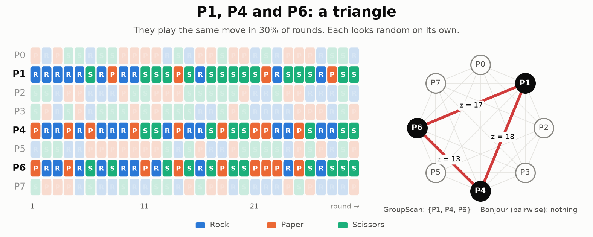

# Beyond Pairs: Detecting Colluding Groups of Agents from Their Moves

As part of committing myself to more independent research, I took part in Apart Research's [AI Collusion Research Sprint](https://apartresearch.com/sprints/ai-collusion-research-sprint-2026-10-23-to-2026-10-25).

With LLM agents now making their way into production systems, we set out to detect collusion in a multi-agent game using only the moves the agents make. For instance, in Rock Paper Scissors:

Prior statistical methods only detect colluding pairs. Our approach extends them to detect a colluding subset of any size in a game of n agents.

## The work

- [Full paper (PDF)](https://pys8vc40ox3z7qxp.public.blob.vercel-storage.com/submissions/ai-collusion-research-sprint-2026-10-23-to-2026-10-25/report-11--WH3aFg6A5ySLUG33YWrxUWFinw9pV5.pdf)
- [Code on GitHub](https://github.com/taruntrivedi3/collusion-detection)
- [Interactive visualization](https://taruntrivedi3.github.io/collusion-detection/viewer/)
- [Submission page on Apart Research](https://apartresearch.com/sprints/projects/beyond-pairs-detecting-colluding-groups-of-agents-from-their-moves-4zhs)
